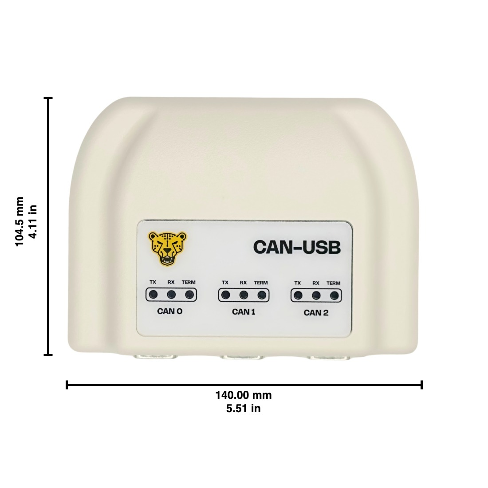

## [Canimal CAN-USB Transceiver](https://canimal.io/products)

## Technical Specifications

## CAN Bus

### Channels

- 3 CAN channels for versatile network configuration.

### Protocol Support

- Full implementation of CAN protocol specification v2.0b, supporting both Standard and Extended frames.

### Data Rates

- **Standard CAN:** Up to 1 Mbit/s
- **CAN FD (CAN0 connector):** Up to 8 Mbit/s. CAN FD is enabled in an upcoming firmware update.

### Payload Capacity

- **Standard CAN:** Up to 8 bytes
- **CAN FD (CAN0 connector):** Up to 64 bytes

### Compatibility

- High-speed CAN connection, ISO 11898-2 compliant.

### Connection Interface

- D-Sub 9-pin connector in accordance with CiA® 106 standards.

### Ground Isolation

- Ground isolation available upon request; standard models feature non-isolated ground.

## USB Connectivity

### Connector Type

- USB 2.0 High Speed over a USB-C connector, for data and power.

### Data Transfer Rates

- USB 2.0 High Speed: 480 Mbit/s

### Power Supply

- Powered via USB-C, eliminating the need for an external power source.

### Termination

- Software-selectable termination for flexible network configurations.

### Operating Temperature Range

- 0 °C to 70 °C ambient
- Industrial and extended enclosure options available upon request.

### Timestamp Resolution

- < 42 μs. Hardware timestamps are enabled in an upcoming firmware update.

###  Product Dimensions

- **Width:** 140.00 mm (5.51 in)
- **Length:** 104.50 mm (4.11 in)
- **Height:** 36.50 mm (1.44 in)

### Firmware Updates

- Downloads and the update guide: [CAN-USB firmware](/products/can_to_usb/firmware/).
